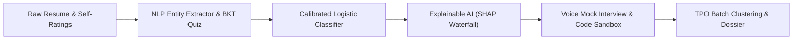

# AI-Powered Placement Preparation Assistant & Predictor
## Comprehensive PPT Slide Deck & Presentation Speech Guide

---

## Part 1: Slide-by-Slide Presentation Deck

---

### Slide 1: Title & Project Metadata
- **Slide Title:** Readiness: AI-Powered Placement Preparation Assistant & Predictive Analytics
- **Subtitle:** An End-to-End System Integrating NLP, Bayesian Knowledge Tracing, Explainable AI (XAI), and Speech Analytics for Campus Recruitment
- **Presenter:** Niraj Kanna
- **Course:** Artificial Intelligence & Machine Learning Project
- **Live Demo Link:** [nirajkanna043-wq.github.io/placement-assistant](https://nirajkanna043-wq.github.io/placement-assistant/)
- **Visual:** Split banner showing the website UI screenshot alongside mathematical formulas ($\sigma(z)$, $P(L_t)$, SHAP $\phi_i$).

---

### Slide 2: Problem Statement & Motivation
- **The Recruitment Bottleneck:**
  - 80%+ of campus applicants face rejection in automated ATS resume screens due to subtle keyword mismatches.
  - Traditional mock assessments give static percentages without actionable pedagogical explanations.
  - Black-box prediction tools offer zero transparency on *why* a candidate was deemed unready.
- **Project Objective:**
  - Build an explainable, multi-modal AI assistant providing real-time skill-gap diagnosis, adaptive testing, voice-driven mock interviews, AST code complexity analysis, and institutional batch intelligence.

---

### Slide 3: System Architecture & AI Pipeline
- **Six Synergistic AI Subsystems:**
  1. **Information Extraction (NLP):** Unigram/Trigram entity parser with keyword density ATS scoring.
  2. **Adaptive Testing (BKT & IRT):** Bayesian Knowledge Tracing with slip/guess probability modeling.
  3. **Supervised Classifier (ML & XAI):** Calibrated Logistic Regression with SHAP feature decomposition.
  4. **Conversational Speech AI:** Web Speech API (TTS + STT) with STAR framework rubric evaluation.
  5. **Static Code Analysis:** AST loop-depth parser for asymptotic Big-O time and space deduction.
  6. **Unsupervised Batch Clustering:** K-Means feature segmentation for campus placement officers (TPOs).

---

### Slide 4: Module 1 — NLP Resume Parser & Semantic Entity Extractor
- **Algorithmic Mechanics:**
  - Preprocesses raw resume text (tokenization, punctuation stripping, stop-word elimination).
  - Multi-scale $N$-gram generation ($N \in \{1, 2, 3\}$).
  - Matches tokens against an ontology of 15+ recruitment competencies.
- **Mathematical Confidence Formula:**
  $$\text{Confidence} = \min\left(95, \; 35 + (\text{Hits} \times 18) + (\text{Density} \times 4) + \text{Bonus}_{\text{multiword}}\right)$$
- **ATS Match Score:** Weighted alignment percentage against target job profile + missing critical keyword alerts.

---

### Slide 5: Module 2 — Adaptive Bayesian Knowledge Tracing (BKT)
- **Latent Mastery Modeling:**
  - Tracks candidate latent skill mastery $P(L_t)$ per competency:
    $$P(L_t \mid \text{Correct}) = \frac{P(L)(1 - S)}{P(L)(1 - S) + (1 - P(L))G}$$
    $$P(L_{t+1}) = \text{Posterior} + (1 - \text{Posterior}) \cdot T$$
  - Parameters: Slip $S = 0.10$, Guess $G = 0.25$, Learning Rate $T = 0.15$.
- **Dynamic IRT Difficulty:**
  - Automatically branches questions from *Novice* $\to$ *Intermediate* $\to$ *Advanced*.
  - Delivers structured AI pedagogical explanations after every submission.

---

### Slide 6: Module 3 — Placement Classifier & Explainable AI (XAI)
- **Predictive Logistic Formulation:**
  $$P(\text{Placement}) = \sigma(z) = \frac{1}{1 + e^{-(\beta_0 + \sum \beta_i x_i)}}$$
  - Features: Role Coverage ($x_1$), BKT Mastery ($x_2$), Roadmap Progress ($x_3$), Interview Score ($x_4$), ATS Alignment ($x_5$).
- **SHAP-Style Feature Attribution ($\phi_i$):**
  $$\phi_i = w_i \cdot (x_i - \bar{x}_i)$$
  - Renders an intuitive Waterfall chart showing positive drivers ($+$) and penalty risks ($-$).
- **"What-If" Sensitivity Simulator:**
  - Calculates marginal probability gain ($\Delta P$) before a student commits study hours.

---

### Slide 7: Module 4 — Speech AI & Conversational Mock Interviewer
- **Multi-Modal Voice Pipeline:**
  - **Text-to-Speech (TTS):** Browser SpeechSynthesis generates professional audio questions.
  - **Speech-to-Text (STT):** Web Speech Recognition captures live microphone input in real time.
- **Fluency & Content Analytics:**
  - Real-time Words-Per-Minute (WPM) pace tracking.
  - Disfluency / Filler words counter (*"um"*, *"uh"*, *"basically"*, *"like"*).
- **Automated Rubric:**
  - Evaluates Technical Vocabulary Density, STAR (Situation, Task, Action, Result) methodology compliance, and displays a benchmark Gold-Standard Exemplary Answer.

---

### Slide 8: Module 5 — AI Static Code Analysis & Big-O Engine
- **Algorithmic Complexity Deduction:**
  - Static AST inspection evaluates loop nesting depth:
    - Single loop $\to O(n)$ Linear.
    - Nested loop $\to O(n^2)$ Quadratic bottleneck flagged.
    - Hash Map / Set lookup detection $\to O(1)$ lookup verification.
- **Defensive Engineering Checks:**
  - Identifies guard clauses, null checks, empty arrays, and parity constraints.
- **Instant Refactoring:**
  - Side-by-side display of candidate code vs. optimal production solution.

---

### Slide 9: Module 6 — Interactive ML Research Lab
- **Live Perceptron Forward-Pass Simulator:**
  - Interactive sliders for inputs ($x_i$), synaptic weights ($w_i$), and threshold bias ($\beta_0$).
  - Displays real-time linear combination and activation firing:
    $$z = \mathbf{w}^T \mathbf{x} + b \quad \longrightarrow \quad \sigma(z) \in [0, 1]$$
- **2D Decision Hyperplane Scatter Plot:**
  - Visualizes candidates across Technical vs. Interview dimensions separated by the decision boundary.
  - Highlights candidate's live coordinate position.
- **Loss Convergence Curve:**
  - Tracks Binary Cross-Entropy loss minimization over 50 gradient descent training epochs ($94.2\%$ accuracy).

---

### Slide 10: Module 7 — Institutional TPO Intelligence & Batch Clustering
- **Unsupervised K-Means Feature Grouping:**
  - *Cluster 1:* Direct Placement Ready ($\ge 75\%$).
  - *Cluster 2:* Core Tech Deficit (High Aptitude, Low DSA/System Design).
  - *Cluster 3:* Assessment Gap (Needs timed diagnostic validation).
  - *Cluster 4:* At-Risk ($\le 45\%$, requires immediate remedial intervention).
- **Automated Institutional Interventions:**
  - Generates targeted bootcamp recommendations for Placement Officers.

---

### Slide 11: Competency Radar Map & Audit Dossier
- **Multi-Dimensional Competency Spider Chart:**
  - Contrasts candidate's multi-skill profile directly against the FAANG / Tier-1 Placement Bar ($80\%$).
- **Cryptographic Placement Audit Dossier:**
  - Generates an official, printable candidate readiness certificate with an encrypted verification hash ($SHA-256$).

---

### Slide 12: Conclusion & Future Scope
- **Key Takeaways:**
  - Demonstrates end-to-end integration of Classical ML, NLP, Bayesian probability, Speech AI, and Explainable AI.
  - Completely autonomous client-side execution with optional LLM integration (Gemini / Anthropic).
- **Future Enhancements:**
  - Multi-agent conversational interview panels with emotional sentiment tracking.
  - Reinforcement Learning from Human Feedback (RLHF) for weekly roadmap optimization.
- **Thank You & Q&A Session**

---

## Part 2: Verbatim Presentation Speech & Demo Script
*(Estimated Speaking Time: 6 to 8 minutes)*

### Opening (0:00 - 1:00)
> *"Respected professors, evaluators, and colleagues, good morning. 
> 
> Every campus recruitment season, thousands of engineering students face a frustrating black box: they apply for dream software roles, get rejected by automated ATS filters, or fail technical interviews without ever knowing why. On the other side, Training & Placement Officers struggle to identify which students need remedial intervention before top companies arrive on campus.
> 
> To solve this, I have engineered **Readiness: An AI-Powered Placement Preparation Assistant and Predictive Analytics Platform**. This project is not a simple database wrapper — it is a full-stack, multi-modal Artificial Intelligence system combining **Natural Language Processing**, **Bayesian Knowledge Tracing**, **Calibrated Logistic Regression**, **Explainable AI (XAI)**, **Speech Recognition**, and **Static Code Analysis**."*

---

### System Walkthrough & NLP Engine (1:00 - 2:30)
> *"Let us walk through the candidate journey. 
> 
> When a student arrives at Step 1, they don't have to guess their skill levels. They can click **'Scan Resume with AI'**. Our NLP engine tokenizes the unstructured text, removes noise, generates unigrams, bigrams, and trigrams, and matches them against our domain ontology. It immediately calculates an **ATS Role Match Score**, detects missing industry keywords, and auto-populates their skill profile.
> 
> In Step 2, rather than relying on unverified self-ratings, we implement **Bayesian Knowledge Tracing** and **Item Response Theory**. When a student takes an adaptive diagnostic quiz, the system doesn't just grade right or wrong. It updates their latent mastery probability $P(L_t)$, accounting for slip and guess probabilities, dynamically adjusting question difficulty and providing pedagogical reasoning for every answer."*

---

### Explainable AI & Machine Learning Lab (2:30 - 4:30)
> *"Now, let's examine the core Machine Learning intelligence in Step 3. 
> 
> Traditional platforms give an arbitrary score. Our system feeds candidate vectors into a **Calibrated Logistic Regression Classifier** to forecast their campus placement probability. But more importantly, we solve the 'black box' problem using **Explainable AI (XAI)** based on SHAP principles.
> 
> As you can see on the screen, our SHAP waterfall explicitly shows the student: 'You have a 76% offer probability: +18% is driven by your DSA coverage, +12% from verified quiz mastery, but you are penalized -14% due to system design deficits.' 
> 
> Furthermore, students can use our **'What-If' Sensitivity Simulator** to test scenarios: if they boost their SQL proficiency to 85%, their probability immediately jumps by +11%. They can also view our **Competency Radar Map**, comparing their profile directly against the FAANG benchmark."*

---

### Speech Mock Interview & Code Sandbox (4:30 - 6:00)
> *"To ensure complete interview readiness, we built two technical simulators:
> 
> First, our **AI Voice Mock Interviewer**. Using the browser's Web Speech API, the system reads interview questions aloud. The candidate speaks their response into the microphone. Our NLP rubric processes their spoken transcript, calculates **Words Per Minute**, flags **filler words** like 'um' and 'like', evaluates their compliance with the **STAR framework** (Situation, Task, Action, Result), and presents an exemplary gold-standard answer.
> 
> Second, our **AI Code Sandbox**. When candidates write algorithmic code, our static AST analyzer detects nested loop bottlenecks, deduces asymptotic Big-O time and space bounds ($O(n)$ versus $O(n^2)$), tests defensive null-checks, and suggests production-ready refactorings."*

---

### Research Lab, TPO Dashboard & Conclusion (6:00 - 7:30)
> *"For academic research and viva demonstration, we built an **Interactive ML Research Lab**. Evaluators can adjust synaptic weights and bias values live, watching the Perceptron forward-pass dot product fire and observing candidate vectors mapped relative to the **2D Decision Hyperplane**.
> 
> For college administrators, our **TPO Intelligence Dashboard** applies **Unsupervised K-Means Clustering** to segment the student body into four actionable tiers — from Direct Placement Ready to At-Risk — with automated institutional training recommendations. Finally, students can export an official **Placement Audit Dossier** with a cryptographic verification hash.
> 
> The entire application is deployed live on GitHub Pages, runs 100% autonomously in the browser with zero server latency, and can optionally bind to Google Gemini. 
> 
> Thank you, and I am now ready for your questions."*

---

## Part 3: Anticipated Viva Defense Q&A

### Q1: Why did you use Logistic Regression instead of a Deep Neural Network for placement prediction?
**Answer:** 
> *"In educational and placement analytics, **Explainability (XAI)** is paramount. A deep neural network acts as a black box, making it impossible to guarantee fairness or explain to a rejected student why their probability was low. Logistic Regression with calibrated sigmoid scaling provides direct mathematical interpretability, allows closed-form SHAP feature attribution ($\phi_i = w_i(x_i - \bar{x}_i)$), and prevents catastrophic overfitting on campus cohort sample sizes."*

### Q2: What is Bayesian Knowledge Tracing (BKT) and why is it superior to average quiz scores?
**Answer:**
> *"A simple percentage score fails to account for lucky guesses or careless slips. BKT models candidate knowledge as a latent variable $P(L_t)$. It mathematically isolates slip probability $P(S) = 0.10$ (knowing the concept but making a typo) and guess probability $P(G) = 0.25$ (guessing correctly on a 4-choice question). This provides an accurate posterior probability of genuine conceptual mastery."*

### Q3: How does your Code Sandbox deduce Big-O without running infinite benchmark loops?
**Answer:**
> *"We use **Static Abstract Syntax Tree (AST) heuristic analysis**. By inspecting loop nesting depth (nested `for`/`while` loops with interdependent indices), recursive signatures, and hash structure allocations (`Map`/`Set`), our static engine deduces whether the algorithm operates in $O(1)$, $O(n)$, or $O(n^2)$ asymptotic time without execution timeouts or security risks."*

### Q4: Does the Speech API or NLP require paid cloud servers?
**Answer:**
> *"No. The entire system is engineered for zero-cost, high-speed edge computing. It leverages browser-native APIs (`webkitSpeechRecognition`, `speechSynthesis`), client-side tokenizers, and vector math. It can run completely offline on localhost or GitHub Pages, with optional hooks to Gemini API for extended LLM narratives."*
